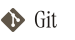

<picture>
  <source media="(prefers-color-scheme: dark)" srcset="assets/hero-dark.svg">
  
</picture>

**Software Engineer · Full-Stack & Applied AI**

**[Portfolio ↗](https://engineering-portfolio.nova-zandkarimi.workers.dev/)** · **[LinkedIn ↗](https://www.linkedin.com/in/nova-zandkarimi-8b289032b/)** · **[Email ↗](mailto:Nova.Zandkarimi@medieinstitutet.se)**

I'm a software developer based in Sweden, with a background in frontend development and experience building full-stack applications.

My work spans React and TypeScript interfaces, backend APIs, relational databases, and AI-powered application features. I enjoy solving problems across the stack, with a focus on usability, maintainability, and understanding the engineering decisions behind the code.

I'm interested in software engineering, full-stack and product engineering, and applied AI.

## Featured project

### [Proper Papers](https://github.com/Novaav/proper-papers)

**Evidence-backed document intelligence**

A full-stack application that transforms business documents into structured records while keeping supporting evidence visible and uncertainty explicit.

The system combines document processing, structured extraction, evidence review, and human oversight.

**Engineering highlights**
- Built a TypeScript/Next.js frontend, Python/FastAPI backend, and PostgreSQL-backed workflows.
- Implemented evidence-linked extraction and review flows that surface missing or conflicting information.
- Added automated testing and CI, with documented evaluation results and limitations.
- Explored model-assisted extraction and documented the trade-offs rather than enabling it without sufficient evidence.

**[Technical case study ↗](https://engineering-portfolio.nova-zandkarimi.workers.dev/projects/proper-papers/)** · **[Source code ↗](https://github.com/Novaav/proper-papers)**

*Completed portfolio project · Source available · No hosted interactive demo*

## Technologies

Technologies I've worked with through education, internships, and projects.

### Languages

<picture><source media="(prefers-color-scheme: dark)" srcset="assets/tech/dark/typescript.svg"></picture> <picture><source media="(prefers-color-scheme: dark)" srcset="assets/tech/dark/javascript.svg"></picture> <picture><source media="(prefers-color-scheme: dark)" srcset="assets/tech/dark/python.svg"></picture> <picture><source media="(prefers-color-scheme: dark)" srcset="assets/tech/dark/sql.svg"></picture>

### Frontend

<picture><source media="(prefers-color-scheme: dark)" srcset="assets/tech/dark/react.svg"></picture> <picture><source media="(prefers-color-scheme: dark)" srcset="assets/tech/dark/nextdotjs.svg"></picture> <picture><source media="(prefers-color-scheme: dark)" srcset="assets/tech/dark/astro.svg"></picture> <picture><source media="(prefers-color-scheme: dark)" srcset="assets/tech/dark/tailwindcss.svg"></picture> <picture><source media="(prefers-color-scheme: dark)" srcset="assets/tech/dark/reactrouter.svg"></picture> <picture><source media="(prefers-color-scheme: dark)" srcset="assets/tech/dark/reactquery.svg"></picture> <picture><source media="(prefers-color-scheme: dark)" srcset="assets/tech/dark/reacthookform.svg"></picture> <picture><source media="(prefers-color-scheme: dark)" srcset="assets/tech/dark/sass.svg"></picture> <picture><source media="(prefers-color-scheme: dark)" srcset="assets/tech/dark/html5.svg"></picture> <picture><source media="(prefers-color-scheme: dark)" srcset="assets/tech/dark/css.svg"></picture>

### Backend & data

<picture><source media="(prefers-color-scheme: dark)" srcset="assets/tech/dark/nodedotjs.svg"></picture> <picture><source media="(prefers-color-scheme: dark)" srcset="assets/tech/dark/express.svg"></picture> <picture><source media="(prefers-color-scheme: dark)" srcset="assets/tech/dark/fastapi.svg"></picture> <picture><source media="(prefers-color-scheme: dark)" srcset="assets/tech/dark/postgresql.svg"></picture> <picture><source media="(prefers-color-scheme: dark)" srcset="assets/tech/dark/prisma.svg"></picture> <picture><source media="(prefers-color-scheme: dark)" srcset="assets/tech/dark/supabase.svg"></picture> <picture><source media="(prefers-color-scheme: dark)" srcset="assets/tech/dark/rest.svg"></picture>

### Testing & engineering

<picture><source media="(prefers-color-scheme: dark)" srcset="assets/tech/dark/jest.svg"></picture> <picture><source media="(prefers-color-scheme: dark)" srcset="assets/tech/dark/cypress.svg"></picture> <picture><source media="(prefers-color-scheme: dark)" srcset="assets/tech/dark/git.svg"></picture> <picture><source media="(prefers-color-scheme: dark)" srcset="assets/tech/dark/githubactions.svg"></picture> <picture><source media="(prefers-color-scheme: dark)" srcset="assets/tech/dark/docker.svg"></picture>

### Design & deployment

<picture><source media="(prefers-color-scheme: dark)" srcset="assets/tech/dark/figma.svg"></picture> <picture><source media="(prefers-color-scheme: dark)" srcset="assets/tech/dark/cloudflare.svg"></picture> <picture><source media="(prefers-color-scheme: dark)" srcset="assets/tech/dark/vercel.svg"></picture> <picture><source media="(prefers-color-scheme: dark)" srcset="assets/tech/dark/vite.svg"></picture>

### Coursework

<picture><source media="(prefers-color-scheme: dark)" srcset="assets/tech/dark/csharp.svg"></picture>

Text version

**Languages** 
`TypeScript` `JavaScript` `Python` `SQL`

**Frontend** 
`React` `Next.js` `Astro` <code>Tailwind&nbsp;CSS</code> <code>React&nbsp;Router</code> <code>TanStack&nbsp;Query</code> <code>React&nbsp;Hook&nbsp;Form</code> `Sass` `HTML5` `CSS3`

**Backend & data** 
`Node.js` `Express` `FastAPI` `PostgreSQL` `Prisma` `Supabase` <code>REST&nbsp;APIs</code>

**Testing & engineering** 
`Jest` `Cypress` `Git` <code>GitHub&nbsp;Actions</code> `Docker`

**Design & deployment** 
`Figma` `Cloudflare` `Vercel` `Vite`

**Coursework** 
`C#` (Luleå University of Technology)

## Background

**Front End Developer — Medieinstitutet**  
Higher Vocational Education · 400 YH credits · Graduated May 2026

Professional frontend internship experience, including work with backend-connected applications and collaborative development.

**Additional university coursework**
- **Introduction to Programming in C# — Luleå University of Technology**, 7.5 hp · Completed October 2026

My projects have expanded my frontend foundation into backend development, databases, and applied AI. I'm continuing to strengthen my knowledge of software architecture, testing, debugging, and production engineering.
